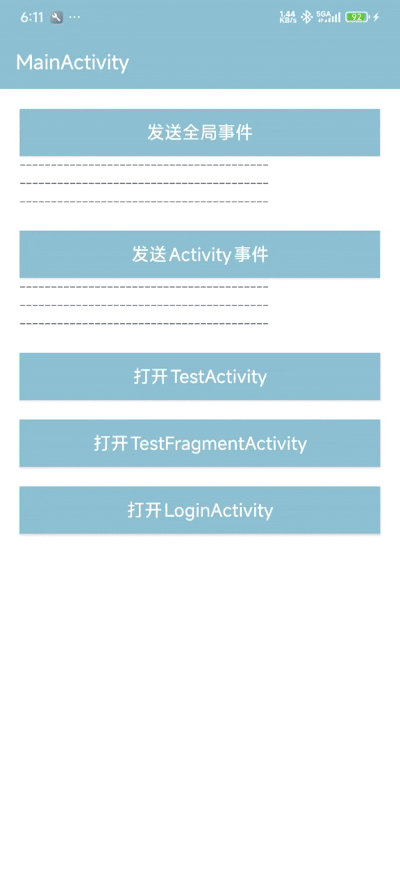

[English](README_EN.md) · [文档索引](docs/README.md)

# FlowBus

FlowBus 是一个基于 Kotlin Coroutines / Flow 的 Flow-first 事件框架，用于处理 Android 和 Kotlin 项目里的事件广播、命名通道、作用域事件和 sticky 最近值。

它解决的是“一个地方发通知，多个地方可能响应”的问题；它不是状态管理框架，也不是直接函数调用、请求-响应或可靠队列的替代品。

## 功能点

| 能力 | 用法入口 | 适合场景 |
| --- | --- | --- |
| 全局事件广播 | `postEvent(...)` / `onEvent<T> { ... }` | 登录成功、后台同步完成、多个页面刷新 |
| owner 局部事件 | `postEventTo(owner, ...)` / `owner.postScopedEvent(...)` | Fragment 通知 Activity、NavBackStackEntry 内部通信 |
| 命名通道 | `eventChannel<T>("name")` | 同样是 `String`，但要区分 Toast、SnackBar、导航命令 |
| Flow-first 订阅 | `eventFlow<T>()` / `collectEvent(flow)` | 先拿到 `Flow`，再做 `map`、`filter`、`debounce`、`combine` |
| sticky 最近值 | `postStickyEvent(...)` / `onEvent<T>(isSticky = true)` | 页面恢复后需要先拿最近一次初始化结果 |
| 发送诊断 | `tryPostEventResult(...)` | 排查订阅数、溢出策略、底层 `tryEmit` 是否拒绝 |
| core 多实例和 scope | `flowbus-core` / `DefaultFlowBus.openScope(...)` | 非 Android、Repository / Worker / Session 级别隔离 |

## 直接安装

Android 项目优先使用 `flowbus`：

[](https://central.sonatype.com/artifact/io.github.logan0817/flowbus)

```gradle
implementation("io.github.logan0817:flowbus:1.1.0")
```

纯 Kotlin / Coroutines / 非 Android 场景使用 `flowbus-core`：

[](https://central.sonatype.com/artifact/io.github.logan0817/flowbus-core)

```gradle
implementation("io.github.logan0817:flowbus-core:1.1.0")
```

模块选择：

1. Android 页面、ViewModel、Fragment、Activity 通信：先看 [`library-android/README.md`](./library-android/README.md)。
2. 非 Android、多实例、显式 scope 生命周期：再看 [`flowbus-core/README.md`](./flowbus-core/README.md)。

## 5 分钟上手

### 1. 定义事件

```kotlin
data class RefreshHomeEvent(val source: String)
```

### 2. 先注册接收事件

```kotlin
viewLifecycleOwner.onEvent<RefreshHomeEvent> { event ->
    viewModel.refreshFrom(event.source)
}
```

### 3. 在接收方进入活跃生命周期、订阅开始后发送

```kotlin
postEvent(RefreshHomeEvent(source = "login"))
```

`onEvent(...)` 注册不等于底层订阅立即就绪；它受生命周期和协程调度影响。普通事件没有 replay，接收方未开始收集或处于非活跃状态时不会补收。后订阅读取最近结果应显式使用 sticky；可恢复的页面状态应使用 `StateFlow`。

这就是最短 Android 接入路径。先记住：发送用 `postEvent(...)`，页面接收用 `onEvent<T> { ... }`。

## 常用场景

### 场景 1：全局刷新通知

适合登录成功、配置更新、后台同步完成后通知多个页面。

```kotlin
data class SyncFinishedEvent(val successCount: Int)

viewLifecycleOwner.onEvent<SyncFinishedEvent> { event ->
    showResult(event.successCount)
}

postEvent(SyncFinishedEvent(successCount = 3))
```

### 场景 2：Fragment 通知 Activity

适合刷新标题栏、请求导航、当前 Activity 内部页面通信。

```kotlin
data object ReloadToolbarEvent

viewLifecycleOwner.onEvent<ReloadToolbarEvent>(from = requireActivity()) {
    renderToolbar()
}

requireActivity().postScopedEvent(ReloadToolbarEvent)
```

这里的 `requireActivity()` 表示事件挂在哪个 owner 作用域，不表示监听者。

### 场景 3：同一类型多个命名通道

适合同样都是 `String`，但业务语义不同的事件。

```kotlin
val toastChannel = eventChannel<String>("ui.toast")

viewLifecycleOwner.onEvent(toastChannel) { message ->
    showToast(message)
}

toastChannel.post("保存成功")
```

### 场景 4：非 Android 或底层 scope 控制

适合 Repository / Worker / Session 级别隔离，或需要多个 `FlowBus` 实例。

```kotlin
val syncScope = DefaultFlowBus.openScope("sync-task", closeWhen = scope)

scope.launch(start = CoroutineStart.UNDISPATCHED) {
    syncScope.flow<SyncProgress>().collect { progress ->
        render(progress)
    }
}

syncScope.post(SyncProgress(percent = 10))
```

示例直接收集普通 Flow，使用 `CoroutineStart.UNDISPATCHED` 先执行收集再发送；上游挂起、`flowOn` 或生命周期门控等组合仍需另行确认实际订阅就绪。

## API 选择速记

| 场景 | 推荐入口 | 是否挂起 | sticky replay | 结果边界 |
| --- | --- | --- | --- | --- |
| 全局轻量广播 | `postEvent(...)` | 否 | 否 | best-effort，极端情况下可能发送失败 |
| 只想知道 `tryEmit` 有没有被拒绝 | `tryPostEvent(...)` | 否 | 否 | 返回 `Boolean`，不代表业务处理成功 |
| 需要发送诊断结果 | `tryPostEventResult(...)` | 否 | 普通 / sticky 都可用 | 返回订阅数、sticky replay 数、溢出策略和结果分类 |
| 按配置进行挂起发送 | `emitEvent(...)` | 是 | 普通 / sticky 都可用 | `SUSPEND` 且存在活跃订阅者时可背压；仍遵循既定溢出策略 |
| 发送到某个 owner | `postEventTo(owner, ...)` / `owner.postScopedEvent(...)` | 否 | 否 | 事件只进入该 owner 对应的局部总线 |
| 命名通道 | `eventChannel<T>("name")` + `channel.post(...)` | 否 | 普通 / sticky 都可用 | 适合长期复用的业务通道 |
| 最短一行监听 | `onEvent(...)` | 否 | 由 `isSticky` 决定 | 自动绑定 `LifecycleOwner` |
| 先拿到 `Flow` 自己组合 | `eventFlow<T>()` / `owner.scopedEventFlow<T>()` | 否 | 由 `isSticky` 决定 | 适合 `map`、`filter`、`debounce` 等操作 |
| 生命周期安全收集任意 `Flow` | `collectEvent(flow) { ... }` | 否 | 取决于传入的 `Flow` | 不只限于 FlowBus |
| 非 Android / 多实例 / scope 生命周期 | `flowbus-core` | 取决于 API | 普通 / sticky 都可用 | 自行管理 `FlowBus`、scope 和协程生命周期 |

`onEvent(...)` 和 `collectEvent(eventFlow(...))` 不是两套体系。前者是 UI 最短写法，后者是先拿 `Flow` 再交给生命周期安全收集；它们监听的是同一条事件流。

```kotlin
viewLifecycleOwner.onEvent<RefreshHomeEvent> { event ->
    render(event)
}

viewLifecycleOwner.collectEvent(eventFlow<RefreshHomeEvent>()) { event ->
    render(event)
}
```

## 边界说明

1. 页面内部长期状态优先用 `StateFlow`，不要把 FlowBus 当状态容器。
2. 明确的一对一调用优先直接方法调用、use case 或挂起函数。
3. `tryPost*Result.accepted = true` 只说明底层 `tryEmit` 没有拒绝，不代表订阅者已经处理完成。
4. `emit*` 仍遵循既定溢出策略；`SUSPEND` 且存在活跃订阅者时可通过挂起施加背压。普通事件无人订阅时不保存，发送完成不等于业务处理成功。必须恢复或可靠完成的操作使用业务状态、数据库或持久化任务机制。
5. sticky replay 与实时广播独立管理；`DROP_LATEST` 下新值即使未送入活跃订阅者的缓冲，也可能成为后订阅者的 replay。sticky 不适合替代长期状态管理。
6. `consumeStickyLatestEvent(...)` 只读取并清空当前 sticky replay，不会阻止其他线程后续写入新的 sticky 值。
7. 日志里的 `eventName`、`scopeName` 不要包含手机号、token、订单号、用户 ID 等敏感信息。


## 1.2.0 候选版本

最新正式版本为 1.1.0。1.2.0 候选新增按通道覆盖缓冲与溢出策略，实现在当前分支中，尚未发布到 Maven Central。

- [通道配置](flowbus-core/README.md#channel-configuration)与 [Android owner 配置](library-android/README.md#android-owner-configuration)
- [本地体验候选版本](CONTRIBUTING.md#candidate-builds)：使用 `io.github.logan0817:flowbus:1.2.0` 或 `io.github.logan0817:flowbus-core:1.2.0`
- [变化、迁移、验证证据与性能边界](docs/release-notes-1.2.0.md)

## 兼容与发布状态

Android 支持 API 21+，发布字节码目标为 Java 8。库使用 Kotlin 1.9.25、Coroutines 1.8.1、Lifecycle 2.6.2、AGP 8.6.1、Gradle 8.7、JDK 17 和 compileSdk/targetSdk 35 构建。消费者的工具链要求与已测组合见[兼容性说明](docs/compatibility.md)。

在依赖仓库中配置 `mavenCentral()`；Android 坐标已传递依赖 core。Compose 和 Navigation 没有单独发布模块，可参考独立的 [Compose](compatibility/compose-consumer/README.md)、[Navigation](compatibility/navigation-consumer/README.md) 和 [NavHost](compatibility/navhost-consumer/README.md) 消费者示例。

## 文档导航

| 目标 | 文档 |
| --- | --- |
| Android 生命周期、owner 与配置 | [Android 使用指南](library-android/README.md) |
| JVM、多实例、scope 所有权与诊断 | [Core 使用指南](flowbus-core/README.md) |
| 挂起回调 | [Android](library-android/README.md#suspend-callbacks) / [core](flowbus-core/README.md#suspend-collection) |
| 排查收不到事件、sticky 或构建问题 | [排障指南](TROUBLESHOOTING.md) |
| 查看版本记录与完整文档 | [文档索引](docs/README.md) / [更新日志](CHANGELOG.md) |
| 参与贡献、报告问题或漏洞 | [贡献指南](CONTRIBUTING.md) / [支持](SUPPORT.md) / [安全策略](SECURITY.md) |

## 仓库结构

`flowbus-core` 由 FlowBus 主仓库直接维护，与 Android 适配共用构建、CI 和发布流程。

| 目录 | 作用 |
| --- | --- |
| `flowbus-core` | Kotlin/JVM 核心，发布坐标 `io.github.logan0817:flowbus-core` |
| `library-android` | Android 适配，发布坐标 `io.github.logan0817:flowbus` |
| `app` | 示例应用与 release instrumentation |
| `compatibility` | 独立消费者 fixture 与设备验证驱动 |
| `benchmarks/jvm` | JVM 性能基准与实测结果 |
| `docs` | 兼容性、发布流程、版本说明与设计记录 |
| `gradle` | 发布与制品验证脚本 |

贡献者可先执行 `./gradlew :flowbus-core:test :library-android:testDebugUnitTest :library-android:lintRelease`。环境要求与完整门禁见[贡献指南](CONTRIBUTING.md)和[发布清单](docs/release-checklist.md)。

## 示例应用



示例源码位于 [`app`](./app) 模块，可直接运行或按当前 debug 配置本地构建；仓库不提交生成的 APK 产物，避免把调试包误当正式渠道分发包。建议按这个顺序看：

1. `MainActivity`：全局事件、owner 事件、非 UI 案例入口。
2. `ScopeCaseActivity`：Activity 作用域事件、`eventChannel`，以及 Activity / Fragment 在同一 owner 作用域内共享接收。
3. `StickyCaseActivity`：同一 owner 内的 sticky 最近状态回放。
4. `LoginActivity`：owner 局部总线示例，表单密码只做本地校验，不进入事件 payload。

## License

[MIT](LICENSE). Core 模块保留其[版权声明](flowbus-core/LICENSE)。参与项目交流请遵守[行为准则](CODE_OF_CONDUCT.md)。
